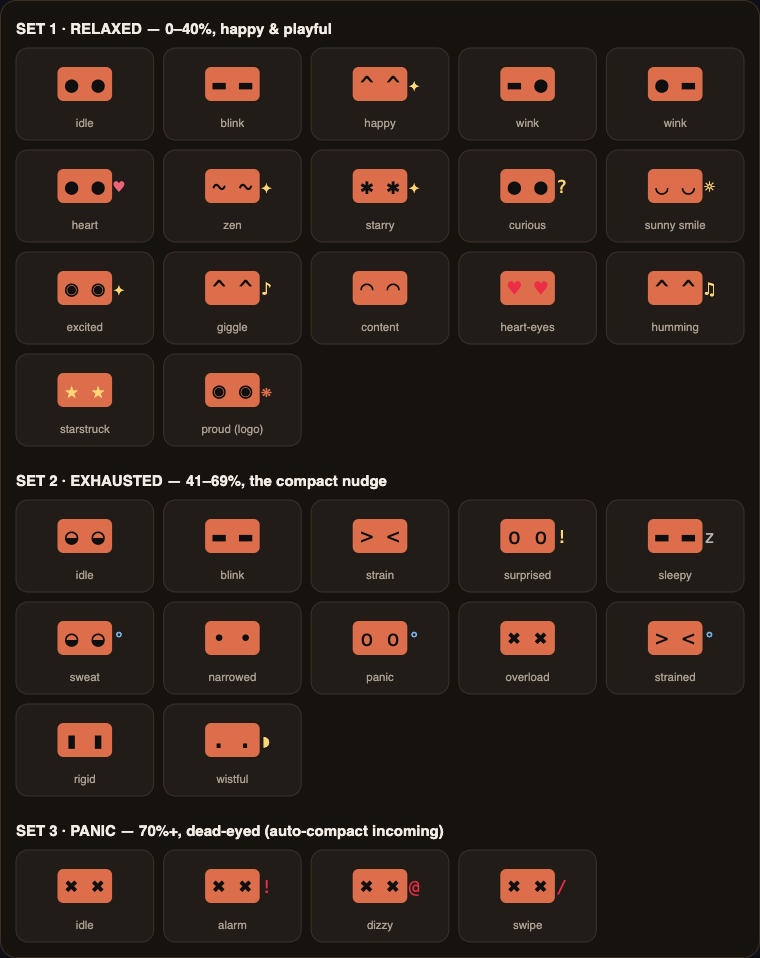

# 🐾 Claude Code CLI Pet

> A pixel-art Claude that lives in your statusline and tells you — through sheer existential dread — when it's time to `/compact`.

## What is it?

A self-contained Bash script that prints one **5-cell mascot frame** every time Claude Code refreshes your statusline (about once a second). It blinks, glances, and emotes — a pixel-art Claude with a chunky orange body — and reacts to how full your context window is.

The animation isn't a fixed loop: every second gets a **weighted-random** frame, so the pet feels alive rather than metronomic. Blinks play as a quick **double blink**, emotes never fire back-to-back, and its gaze settles to the side for a few seconds at a time — a resting pose, not a flash.
<p align="center">
  
</p>

<h3 align="center">
  <a href="https://amirya412.github.io/claude-code-pet/">▶ Try the interactive demo</a>
</h3>

## Why it's nice

- **Zero forks, zero temp files.** Pure Bash builtins + a seeded integer hash.
- **Never loops.** Weighted-random frames feel alive, not robotic.
- **Context-aware.** Three tiers — relaxed (0–40%), exhausted (41–69%), panic (70%+) — a building nudge to `/compact`.
- **No jitter.** Every frame is exactly 5 terminal cells wide.
- **One file.** Drop it in, point your statusline at it.
- **Mostly idle.** It rests, blinks, and glances far more than it emotes.

## Expressions

The pet has three moods, switched by context-window usage:

- 🙂 **Relaxed** (`0–40%`) — happy & playful. Emotes roughly every 12 seconds.
- 😩 **Exhausted** (`41–69%`) — strained. Emotes more often (~every 9 s) — your cue to compact.
- 💀 **Panic** (`70%+`) — `✖ ✖` eyes, blinking fast and rattled. Auto-compact is closing in.

> [!WARNING]
> Past **41%** the pet looks exhausted; past **70%** it flips to a panic `✖ ✖` stare — your signal to `/compact` before auto-compact kicks in around 95%.

Here's the full cast:

<p align="center">
  
</p>


## Install

### Requirements

- **[Claude Code](https://code.claude.com/docs)** — Anthropic's CLI; see the docs to install.
- **[`jq`](https://jqlang.github.io/jq/)** — **required**: the installer edits `settings.json` with it, and the statusline wrapper parses the context JSON on every redraw. Install with `brew install jq` (macOS) or `sudo apt install jq` (Debian/Ubuntu).
- **Bash ≥ 3.2** — the pet and wrapper are Bash scripts (macOS/Linux have it; on **Windows** run the install in **Git Bash or WSL**, not PowerShell).
- **A Modern Terminal** - For color support. 

### One command

```bash
curl -fsSL https://raw.githubusercontent.com/AmirYa412/claude-code-pet/main/claude-pet-install.sh | bash
```

Cloned the repo instead? Run `bash claude-pet-install.sh`.

It drops the pet **and** the statusline wrapper into `~/.claude` and wires `settings.json` (`refreshInterval: 1`, which drives the ~1 fps animation) with a timestamped backup.

> [!NOTE]
> **Already have a statusline?** The installer detects it and shows an arrow-key menu (**↑/↓ then Enter**):
> - **Replace it with the full pet line** — pet · model · directory · git branch · context %.
> - **Keep your statusline and add the pet in front** — the pet still cycles all three moods.
>
> A timestamped backup of `settings.json` is kept either way. Fresh installs (no existing statusline) go straight to the full line with no menu.

## Claude Desktop pet

Prefer the **Claude desktop app**? The [`desktop-pet/`](./desktop-pet) folder is a Claude Code plugin, `pixel-pet`, that puts an animated pixel Claude above the prompt (it works in the terminal too), next to a statusline: **model · dir · branch · CTX bar · session cost**. Worktrees show as `🌲 repo/sub`, just like the bash pet.

- **Same moods**: relaxed (0–40%), exhausted (41–69%), panic (70%+), each with the same emotes as the statusline pet.
- **Calm when idle**: mostly still, with double blinks, glances and the odd beat: a wave, a yawn, floating hearts, nodding off, a coffee break or a nervous alarm, depending on the mood.
- **Reacts to Claude**: a greeting when you send a message (lightbulb, a letter, a hop, a wave...), headphones or a thought bubble while it thinks, and a prop per tool: a hammer for edits, a pencil for new files, a magnifier for reads, a globe for the web, a keyboard for commands, a mini clone for subagents and a clipboard for to-dos. It cheers when a turn ends, sweats on errors, stretches after `/compact` and falls asleep after 10 idle minutes.
- **Light on your machine**: every animation is discrete SVG/SMIL in the app's renderer, which wakes only when a frame changes. The plugin redraws only on events, never on a timer, and runs no processes.

### Install

In the desktop app, click **+** next to the prompt box, then **Plugins** → **Add marketplace** → `AmirYa412/claude-code-pet` → **Add plugin** (`pixel-pet`).

At the prompt of a terminal session:

```
/plugin install pixel-pet --marketplace AmirYa412/claude-code-pet
```

From a shell:

```bash
claude plugin install pixel-pet --marketplace AmirYa412/claude-code-pet
```

---

<p align="center"><sub>Made with 🐾 for Claude Code statuslines.</sub></p>
