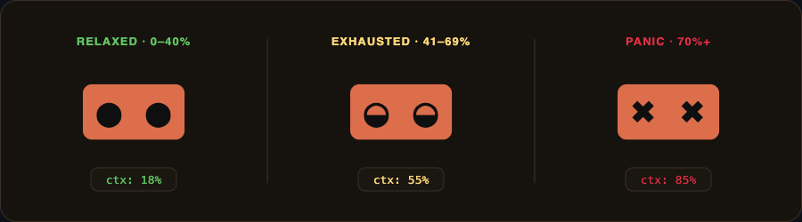
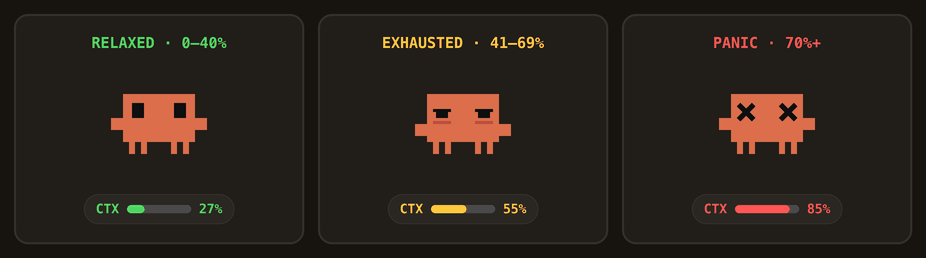
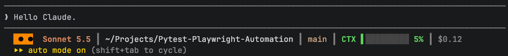
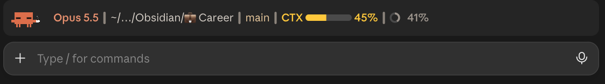

# 🐾 Claude Code Pet

> A pixel-art Claude that tells you — through sheer existential dread — when it's time to `/compact`.

A tiny orange Claude that lives next to your prompt, blinks, glances and emotes, and gets more and more stressed as your context window fills up. Pick your home:

- **[⌨️ Terminal](#terminal)** — a Bash statusline for Claude Code in your terminal.
- **[🖥️ Claude Desktop app](#desktop)** — a plugin above the prompt in the Code tab that also reacts to what Claude is doing.

<p align="center">
  
</p>

<p align="center">
  
</p>

<h3 align="center">
  <a href="https://amirya412.github.io/claude-code-pet/">▶ Try the interactive demo</a>
</h3>

## 🎭 Moods

Both versions switch mood by context-window usage:

| Mood | Context | Look |
| :- | :- | :- |
| 🙂 **Relaxed** | `0–40%` | Happy and playful |
| 😩 **Exhausted** | `41–69%` | Heavy eyelids, emotes more often — your cue to compact |
| 💀 **Panic** | `70%+` | `✖ ✖` eyes, rattled — compact before auto-compact at ~95% |

<a id="terminal"></a>
## ⌨️ Terminal

<p align="center">
  
</p>

- **Pure Bash**: no forks, no temp files, a fixed 5-cell frame that never jitters.
- **Never loops**: each second gets a weighted-random frame.

**Requirements**
- [Claude Code](https://code.claude.com/docs) in your terminal
- [`jq`](https://jqlang.github.io/jq/) (`brew install jq` or `sudo apt install jq`)
- Bash ≥ 3.2 (Git Bash or WSL on Windows)

```bash
curl -fsSL https://raw.githubusercontent.com/AmirYa412/claude-code-pet/main/claude-pet-install.sh | bash
```

Already have a statusline? The installer asks whether to replace it or put the pet in front, and backs up `settings.json` either way.

<a id="desktop"></a>
## 🖥️ Claude Desktop app

<p align="center">
  
</p>

- **Reacts to Claude**: greets your messages and works along with each tool (🔨 edit, 🔍 read, 🚀 push, 🧪 tests…), two animations per tool.
- **Live statusline**: model · dir · branch · CTX bar · cost, light on CPU.

**Requirements**
- The Claude desktop app, Code tab (Claude Code with plugin support)

```bash
claude plugin install pixel-pet --marketplace AmirYa412/claude-code-pet
```

Or in the app: **+** → **Plugins** → **Add marketplace** `AmirYa412/claude-code-pet` → add **pixel-pet**. Desktop app only; Cowork doesn't load plugins.

---

<p align="center"><sub>Made with 🐾 for Claude Code.</sub></p>
